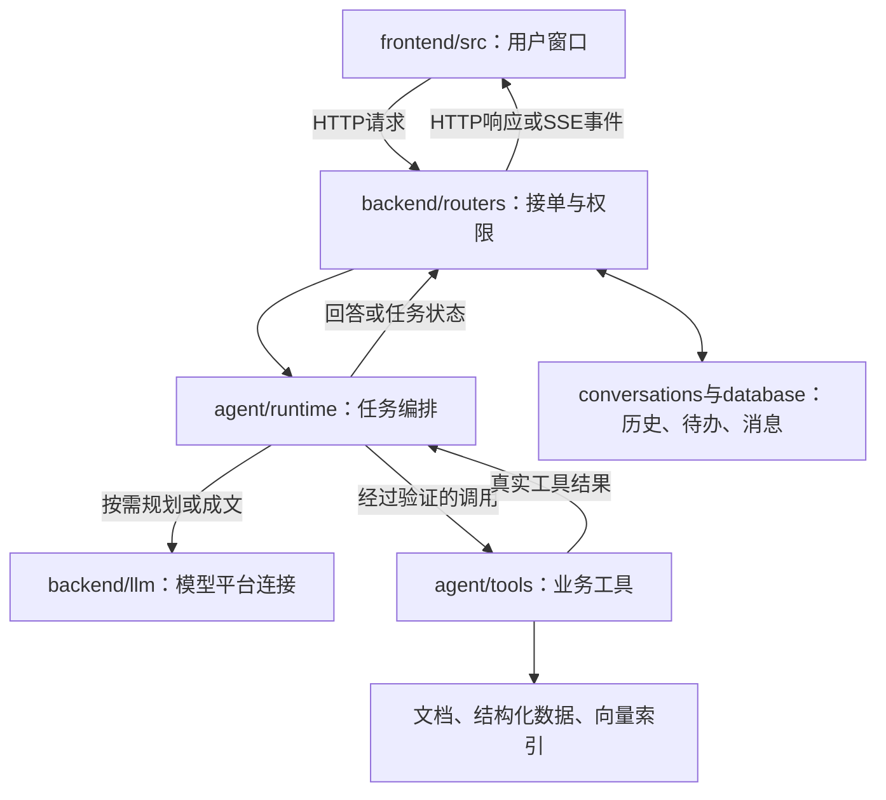
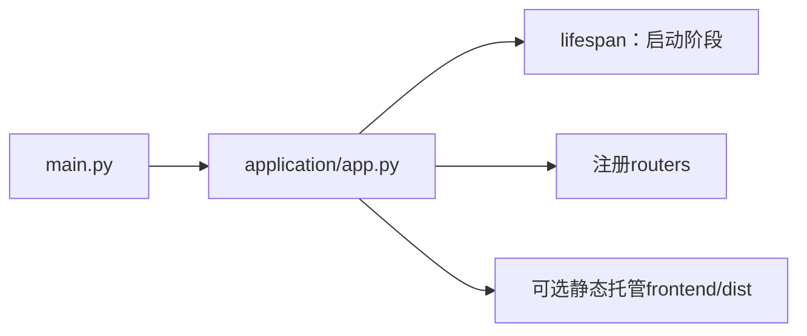
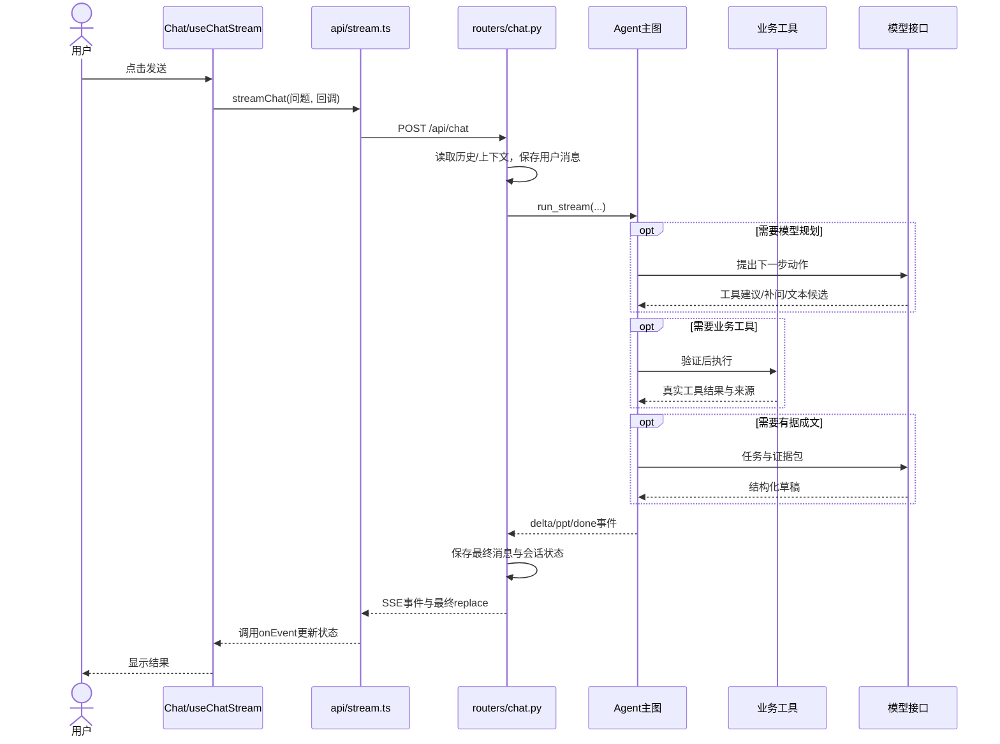
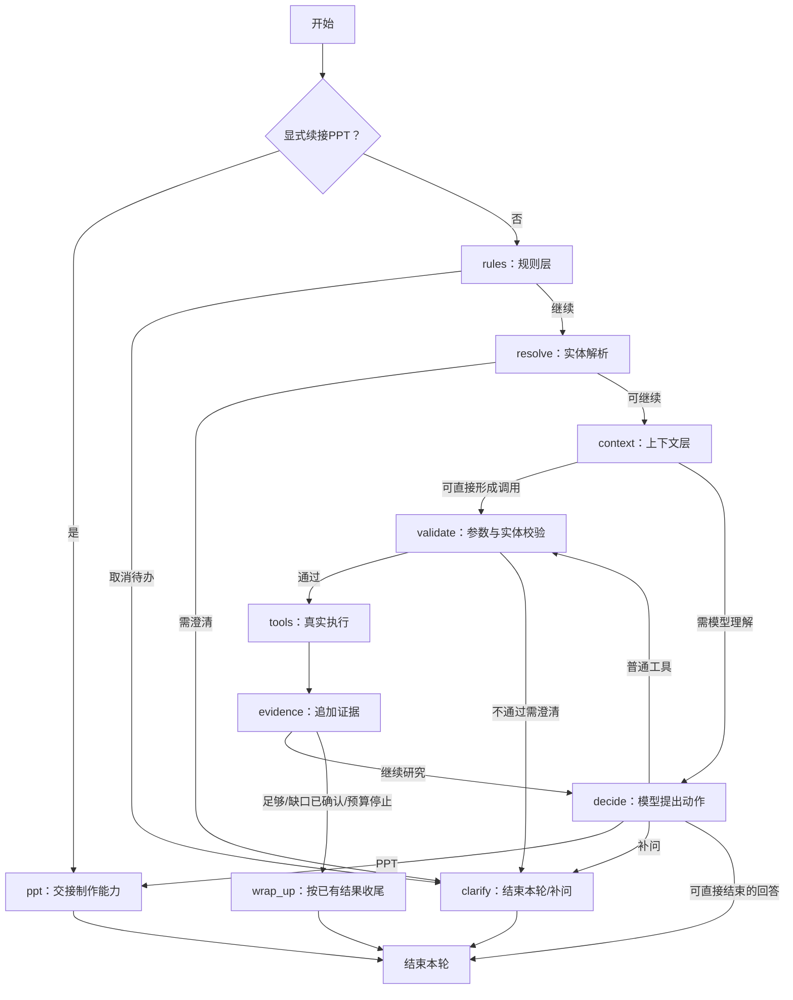
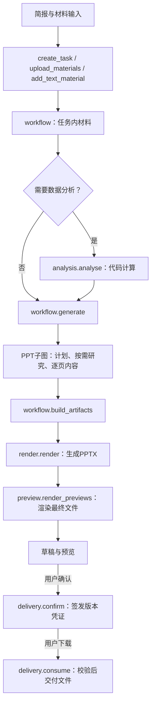

# 当前工程调用关系与学习指南

依据：2026-10-25当前磁盘中的代码。本文只解释工程，没有启动业务服务、查询知识库或调用真实模型。文件和行号均指本次阅读时的源码位置，后续修改后行号可能变化。

配套：[函数级调用索引](D:/guet-agent-微调/docs/学习导航-20261025/函数级调用索引.md)。它列出可定位的直接调用，并单独补充35条经源码核对的HTTP、注册表、图节点注册和默认回调关系。

## 1. 先把系统看成一个办事窗口

可以用一个具体问题来理解：“学校的学业预警规则是什么？”

- **前端是窗口**：收集问题、显示结果、让你选择文件或确认下载。
- **后端路由是接单处**：识别谁在访问、请求参数是什么、属于哪个会话。
- **Agent主图是调度员**：根据规则、上下文及模型建议，决定下一步。
- **工具是具体办事岗位**：查制度、查课程、执行计算，或者制作PPT。
- **模型是理解与组织表达的参与者**：可以提出动作、组织文字；它的建议还需要程序验证后才能执行。
- **数据库与知识资料是档案**：保存消息、任务、文档、结构化课程与可检索片段。

这些角色有联系，但不应该混为一层。例如“模型决定查什么”和“程序真正执行查询”是两步。



图中的箭头是业务通信关系，不表示所有模块每次都要执行。聊天、知识入库、PPT制作是不同路径。

## 2. 当前目录如何分工

| 位置 | 它负责什么 | 初学时先看哪里 |
| --- | --- | --- |
| `frontend/src/views/` | 聊天、登录和管理页面 | `Chat.vue` |
| `frontend/src/components/` | 页面里的可复用界面块 | `PresentationComposer.vue`、`PptReview.vue` |
| `frontend/src/composables/` | 把交互流程从页面抽出来 | `useChatStream.ts` |
| `frontend/src/store/` | 页面之间共享的状态 | `chat.ts`、`auth.ts` |
| `frontend/src/api/` | 请求后端、读取SSE、下载文件 | `stream.ts`、`presentation.ts` |
| `frontend/src/types/` | 前端数据形状声明 | `chat.ts`、`presentation.ts` |
| `backend/main.py` | 保持稳定的启动入口 | 它导入`application.app.app` |
| `backend/application/` | 装配应用、启动流程、注册路由 | `app.py`、`lifespan.py` |
| `backend/routers/` | 接收HTTP输入并返回响应 | `chat.py`、`ppt.py`、`admin.py` |
| `backend/core/` | 配置、公共错误、工程路径 | `config.py`、`paths.py` |
| `backend/security/` | 登录、令牌和权限 | `auth.py`、`passwords.py` |
| `backend/database/` | 用户、消息、会话、文档等数据库模型 | `db.py` |
| `backend/conversations/` | 历史、上下文、可信实体与待办的保存 | `conversation_context_store.py` |
| `backend/entities/` | 识别专业/课程等实体并校验参数 | `entity_resolver.py`、`entity_calls.py` |
| `backend/documents/` | 文档转换、表格、分块和资料可用性 | `mdify.py`、`document_chunks.py` |
| `backend/llm/` | 构建模型消息、读取API配置、适配平台协议 | `llm_api_client.py` |
| `backend/agent/core/` | Agent使用的任务、工具、证据和回答契约 | `contracts.py`、`task.py`、`evidence.py` |
| `backend/agent/runtime/` | 主图、路由、工具执行与回答交付 | `graph.py` |
| `backend/agent/tools/` | 各种业务工具及内部实现 | 每个工具的`tool.py` |
| `backend/agent/skills/` | 应用业务Skill的职责、输入与工具范围 | `create_presentation.json` |
| `scripts/` | 入库、转换、维护、评测等命令行工具 | 按当前维护任务选择，不按顺序全部运行 |
| `deploy/` | 服务启动、部署与模型平台参数 | `llm-api.json` |
| `backend/tests/`、工具内`tests/` | 回归与行为验证 | 读完一个功能再看对应测试 |
| `测试集/` | 验收问题及标注 | 不属于在线请求执行层 |
| `训练集/compiler/` | 离线场景编译与轨迹一致性验证 | 不属于用户聊天的在线入口 |
| `backend/data/` | 结构化课程、实体、适用范围等数据 | `plan_db.json`等是数据，不是函数 |
| `final-md/`、`guet数据文件/` | 正式知识与原始材料 | 工具读取/索引它们，而不是直接执行它们 |
| `model/`、`qdrant_local/` | 检索模型与本地向量索引 | 使用生成API不等于不需要检索模型 |
| `third_party/` | 固定版本的上游复用包 | 当前PPT Master为独立评估适配 |
| `docs/`、`_work/` | 设计、说明和当前工作材料 | 不能把历史架构说明当作当前源码 |
| `.agents/`、`.git/` | 开发助手能力、版本管理 | 与产品运行时Skill不是同一层 |

## 3. 启动流程与请求流程分开读

启动时，`backend/main.py`导入`application/app.py`。后者创建FastAPI实例、注册路由，并在存在前端构建产物时挂载静态页面。

`application/lifespan.py::lifespan()`负责启动阶段的API配置读取、数据库初始化、管理员初始化、文档中断状态恢复和既有运行配置核对。这些不是每次提问都重新执行的步骤。



学习重点：Python模块导入、应用实例、装饰器、生命周期。不要因为一个函数“定义在文件里”，就认为它在导入时已经执行。

## 4. 一次聊天怎样走完

源码阅读顺序：

1. `frontend/src/views/Chat.vue`：模板事件使用`send()`，真正交互逻辑来自`useChatStream()`。
2. `frontend/src/composables/useChatStream.ts::send()`：收集问题，必要时创建会话，调用`runStream()`。
3. 同文件`receiveStream()`调用`frontend/src/api/stream.ts::streamChat()`，并提供处理事件的回调。
4. `streamChat()`发送`POST /api/chat`，读取返回流。
5. `backend/routers/chat.py::chat()`检查会话/身份并交给`_chat()`。`_chat()`读取历史与上下文，保存用户消息，返回流式响应。
6. `_chat.generate._delta_source()`迭代`agent.runtime.graph.run_stream()`，后者进入主图。
7. 主图根据条件调用规则、实体、上下文、模型、工具、证据与回答交付模块。
8. 主图事件回到`_chat.generate()`，最终回答和会话状态写入数据库，并转换为SSE事件。
9. 浏览器先应用`content`增量，收到`replace`时用最终正文覆盖；`[DONE]`表示协议完成。



序列图展示主要交互方向，不保证每条数据库写入与网络事件严格按图中简化顺序发生；具体顺序以`_chat.generate()`为准。

## 5. 主图不是一条永远直走的流水线

实际组装位置是`backend/agent/runtime/graph.py::build_agent_graph()`。`add_node()`登记处理节点，`add_conditional_edges()`决定下一步。



几个需要分清的函数：

| 函数/模块 | 职责 | 不应混淆的事 |
| --- | --- | --- |
| `funnel.rule_route()` | 识别当前支持的明确规则动作，如取消有效待办 | 不是完整校园业务意图分类器 |
| `entity_validation.resolve_entities()` | 解析本轮实体并形成任务解释 | 实体匹配不等于政策结论 |
| `funnel.context_route()` | 尝试承接有效待办中的明确参数 | 当前实现是确定性匹配，不是独立语义模型 |
| `graph.agent_decide()` | 调用模型，记录其建议动作 | 不直接执行任意模型建议 |
| `entity_validation.validate_entity_calls()` | 检查工具、实体、范围与参数 | 校验通过不代表事实已查询完成 |
| `tool_execution.execute_tools()` | 在预算和去重约束下执行工具 | 工具结果不能由模型虚构 |
| `tool_evidence.append_evidence()` | 收集真实结果与来源 | 来源ID存在不自动证明语义充分 |
| `answer_service.complete_answer()` | 判断交付动作，必要时计算或有据成文 | 不是每个请求都必须再调用一次成文模型 |

## 6. 工具里面的三层怎么读

以`search_regulations`为例：

```text
runtime/tool_execution.execute_tools
    → runtime/registry.call("search_regulations", args)
        → 验证Schema、资料可用性
        → search_regulations/tool.py中的执行实现
            → scripts/query_plan.py：形成查询计划
            → scripts/retrieval.py：召回、融合、去重、重排与选择
            → 结构化ToolResult与Source
    → registry.render(result)：得到给模型看的观察文本
    → tool_evidence.append_evidence：登记来源
```

- `schemas.py`回答“调用工具需要什么参数”。
- `tool.py`回答“工具做什么，成功/缺依据/失败怎样表达”。
- `renderer.py`回答“如何把结果解释给模型”。
- `scripts/`是这个工具的内部实现，不是项目根目录维护脚本的同义词。

`registry.call()`中有两种分发：计算器和部分检索路径直接调用内部函数；其他工具通过注册的LangChain工具对象`.invoke()`执行。因此不能把静态索引里“没有直接调用方”解释为工具没有被使用。

检索流程中的重要区别：Embedding用于把文字变为可检索表示；BM25偏词面匹配；重排对候选再排序；成文模型根据选定材料组织回答。这些都是不同工作。

## 7. PPT有两种入口，不能只看聊天路径

### 材料制作界面

`PresentationComposer.vue`通过`api/presentation.ts`访问`routers/ppt.py`：



材料解析在上传时执行；数据分析由用户提交分析请求时执行；确认与下载是之后的用户操作。它们不都属于一次HTTP请求。

### 聊天中请求PPT

主图选中PPT路径后，经`runtime/presentation_handoff.py::ppt_handoff()`交给`tools/create_ppt/tool.py::run_stream()`，再进入已有PPT子图。主图不负责具体逐页排版。

指定页修订由`PptReview.vue::revise()`发起，经API、路由进入`workflow.revise()`。`generate.revise_slides()`负责目标页文字，程序负责只替换/拆分/追加指定页、保留其他页并形成新版本。

当前默认制作器仍是`python-pptx`。`scripts/ppt_master.py`是独立评估适配器，并非所有制作请求都经过它。实际模型是否稳定完成规划和成文，也不能从本地替身样例推断。

## 8. 怎么使用函数级索引

配套的《函数级调用索引》覆盖本次读取的243个第一方代码文件：后端非测试源码、根目录维护脚本、场景编译源码和前端`src`中的TS/Vue脚本。共提取1527个函数/方法定义、146个类。Vue的纯模板/类型文件可能没有独立函数。

它区分四件事：

1. **导入依赖**：文件A需要文件B，不代表A每个函数都调用B。
2. **可定位的函数调用**：通过函数名、导入别名、局部定义及有限明确对象关系定位的调用。
3. **框架调度**：FastAPI路由、LangGraph条件边、Vue模板事件，需结合上面的图阅读。
4. **动态/外部调用**：传入回调、注册表、第三方对象方法等，索引不强行猜目标。

这些是源码静态关系，不是某次请求的实际执行轨迹。嵌套回调、装饰器和默认参数也可能改变执行时机。没有调用方记录不代表函数可删除；有调用关系也不代表每次请求都会执行它。

测试目录、第三方包、依赖库、模型权重和资料不展开其全部函数。Python动态生成的方法、Vue编译器生成的渲染函数也不属于提取的源码定义。

## 9. 建议按这七步学习

| 顺序 | 知识点 | 结合项目要回答的问题 |
| --- | --- | --- |
| 1 | Vue事件、组合式函数、Pinia | 点击发送后，页面怎样找到`send()`？输入状态和会话状态分别放哪里？ |
| 2 | HTTP、FastAPI、Pydantic、Depends | JSON参数怎样进入Python函数？当前用户和数据库会话由谁提供？ |
| 3 | `async/await`、异步生成器、SSE | `yield`和`return`有什么区别？为什么需要最终`replace`？ |
| 4 | 状态机、条件路由、LangGraph | 节点函数改变哪些状态？谁决定下一步？补问为什么结束本轮？ |
| 5 | 工具Schema、注册表、数据契约 | 模型建议与真实执行在哪里分开？工具结果如何统一？ |
| 6 | RAG、Embedding、BM25、重排、引用 | 一份原文怎样变为候选片段？检索分数为什么不等于事实正确？ |
| 7 | 任务隔离、局部修改、版本与文件交付 | PPT为什么保存稳定页ID和revision？为什么新版本需要再次确认？ |

每次选一个函数，只回答四个问题：**谁调用它、接收什么、调用谁、把结果交给谁**。先跟通聊天闭环，再进入检索算法或PPT内部，不必一开始逐行读完所有文件。
