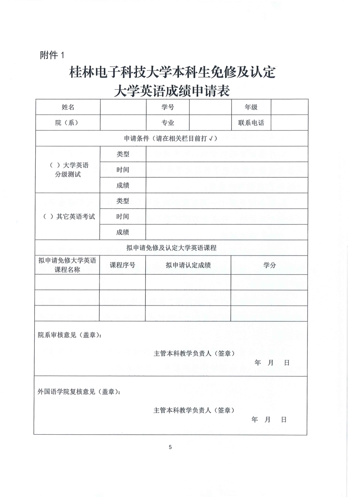
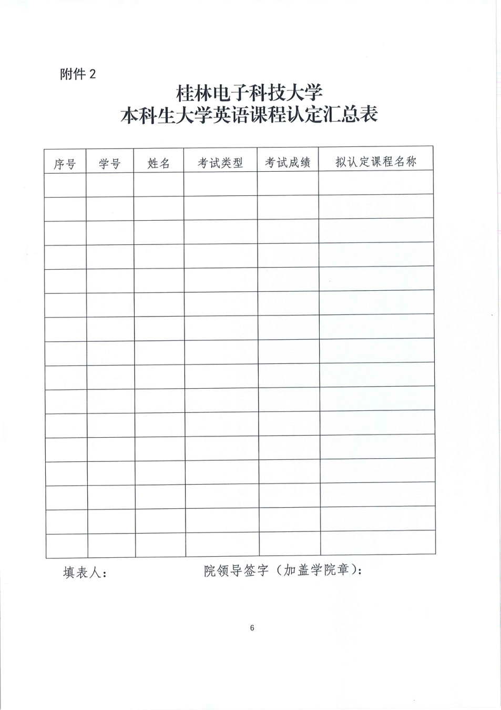

# 桂林电子科技大学“大学英语”课程替换及成绩认定办法(试行)

## 一、 课程替换

“大学英语”课程替换是指学生在通过大学英语四级考试(CET-4)之后,按需修读高阶替换课程,一门高阶替换课程的成绩和学分可以替换未选课修读的“大学英语”(3-4)中任一门的成绩和学分。

高阶替换课程与“大学英语”课程的替换规则由外国语学院在本科教学信息平台-课程替代规则库录入完成,学生即可在本科教学信息平台一学分认定-课程替代申请模块操作课程替换。

## 二、成绩认定

#### (一) 认定条件

参加全国大学英语四、六级考试、托福、雅思等高水平英语考试,达到以下要求者可申请认定“大学英语”(2-4)3门课程。

1.大学英语四级考试成绩达到425分及以上;

2.大学英语六级考试成绩达到425分及以上;

3.雅思考试成绩达到6.0分及以上(成绩两年内有效);

4.托福考试成绩达到75分及以上(成绩两年内有效)。

#### (二)认定标准

1.外国语学院根据课程目标达成情况以及对毕业要求指标点的支持情况进行认定,换算标准如下(折算后四舍五入取整)。

| 类别 | 成绩 A | 大学英语成绩 |
| --- | --- | --- |
| CET4 | 425 ≤ A < 567 | A × 0.1764 |
| CET4 | A ≥ 567 | 100 |
| CET6 | 425 ≤ A < 500 | A × 0.2 |
| CET6 | A ≥ 500 | 100 |
| 托福 | 75 ≤ A < 100 | A |
| 托福 | A ≥ 100 | 100 |
| 雅思 | A = 6.0 | 80 |
| 雅思 | A = 6.5 | 85 |
| 雅思 | A = 7.0 | 95 |
| 雅思 | A ≥ 7.5 | 100 |

若全国大学英语四、六级及雅思、托福等考试计分体制调整,学校将对上述成绩认定标准作相应调整并公布。

2.一项考试成绩只能申请认定一门“大学英语”课程。

#### (三)认定程序

1.学生须在规定选课时间内对拟认定的“大学英语”课程进行选课;

2.学生登录智慧校园本科教学信息平台选定已选课未修读的“大学英语”课程,将《桂林电子科技大学本科生免修及认定大学英语成绩申请表》(附件1)和相应成绩证明材料上传,提出认定申请;

3.学生所在学院审核学生认定申请;

4.外国语学院对全校认定申请进行复核和汇总,每学期第十周结束前将《桂林电子科技大学本科生大学英语课程认定汇总表》(附件2)报教务处备案;

5.教务处于第十一周在教务处主页公示通过认定申请名单。

公示期无异议的,任课老师即可录入成绩。

#### (四)补充说明

1.学生可根据自身实际情况选择是否申请进行大学英语成绩和学分认定,认定成功后也可自行选择是否进行后续的“大学英语”课程修读。

2.学生申请进行“大学英语”课程成绩和学分认定时,采取英语水平考试成绩换算分数和“大学英语”实际成绩之间就高原则进行认定。

3.本办法适用于英语语种学生,修读其它外语语种学生参照本办法执行,由外国语学院和教务处负责解释。

## 附件1（原表）

## 附件2（原表）

